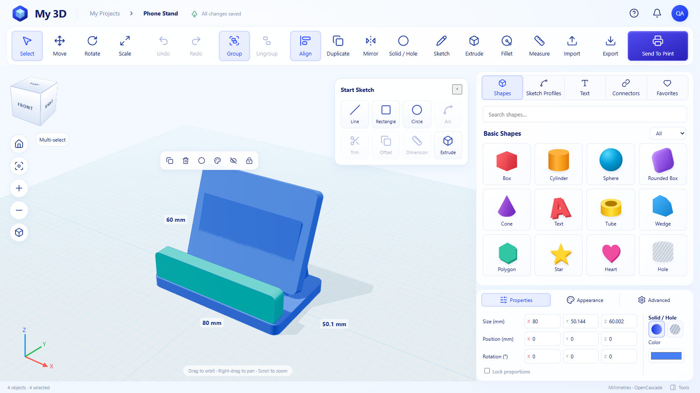

<h1>My 3D</h1>

Turn a little idea into something you can print.

Build with colourful shapes, set exact dimensions, cut holes and make dimensioned profiles. Start with a phone stand, nameplate or box with a hole. Save editable projects and take STL, 3MF or STEP files to your slicer.

My 3D runs inside One Workspace or as a standalone Windows application. Its browser interface adapts to desktop, tablet and phone screens. The Windows download includes the browser assets and OpenCascade WASM kernel in one executable; Node, Python and Docker are not needed to run it. Keep private data on an NTFS volume outside the executable.

[Windows releases](https://github.com/oneworkspacestudio/my-3d/releases) · [Getting started](docs/SETUP.md) · [Capabilities and limits](docs/ACCEPTANCE.md) · [Engine and source audit](docs/ENGINE.md)

This is a new application, **not a TweakCAD fork**. The repository linked by TweakCAD's official website was unavailable during the audit. My 3D uses Replicad and OpenCascade instead. This first preview implements shape modelling and dimensioned profile extrusion; it does not include a general sketch constraint solver or every feature in the master brief. The capability matrix lists the remaining work.

